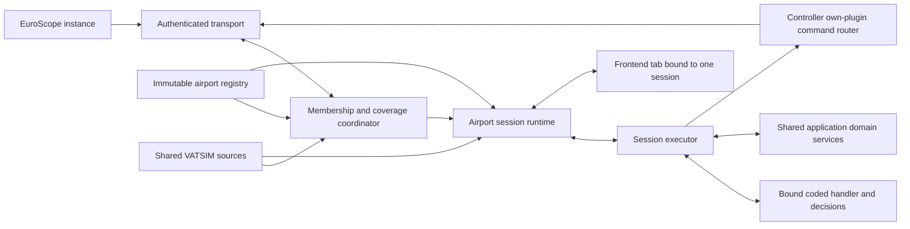
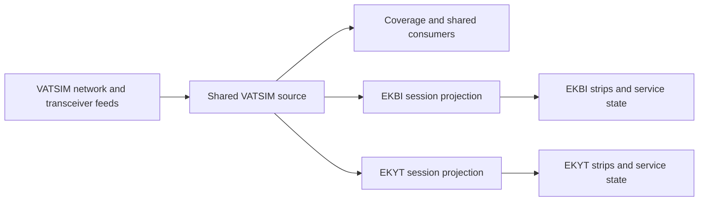
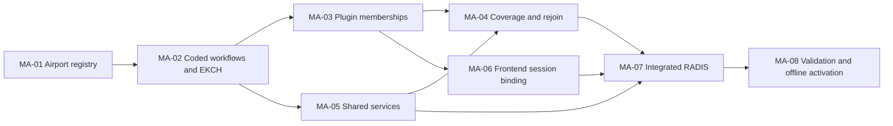

# Multi-airport architecture proposal

Status: draft proposal for review; not an accepted ADR.

Date: 2026-10-29. Epic plan drafted: 2026-11-02. Reviewed: 2026-10-30; delivery decisions confirmed on
2026-11-01 for RADIS features, existing EKCH execution, shared services, and
coordinated offline deployment. User-selected directions are recorded; this is not a
formally accepted ADR or a claim of completed application integration.

Independent final Astra review: 2026-11-02. No architecture/epic-planning
blockers remain; one region-resource validator defect was corrected and verified.
See the [review outcome](planning-readiness.md#independent-final-review-2026-11-02).

Read the [HTML edition with diagrams](architecture-proposal.html) for a formatted
version of this proposal. This Markdown document remains the editable source.

Inputs: [requirements discovery](../multi-airport-support.md),
[configuration requirements](configuration-design-requirements.md),
[RADIS design notes](radis-reference-notes.md),
[RADIS prototype review](radis-prototype-review.md), and
[ENGM reference notes](engm-reference-notes.md), and
[consistency review and decision register](planning-readiness.md).

## Proposed direction

Keep an airport session as the boundary for operational state. Add explicit
membership of a EuroScope instance in several airport sessions, independently
of its physical WebSocket connection. Load immutable airport definitions from
repository configuration and bind compiled workflow handlers with typed
settings alongside reusable services. Keep frontend views in code, selected through an airport/view
registry, with one selected session per browser tab.

Use one authenticated EuroScope connection with multiplexed, explicitly scoped
session messages. Retaining that connection when an instance has no active
airport memberships lets coverage changes reattach it automatically. Leaving
EKBI must not disconnect EKYT or require an EKDK controller to reconnect the
whole plugin.

Keep VATSIM acquisition shared at application scope. Network-data and
transceiver feeds each have one fetch/cache pipeline per backend process,
consumed by all relevant airport sessions and services. Only airport-specific
projections and operational state are session-scoped; adding an airport must
not add another upstream poller or full copy of the network snapshot.

PDC is also an application-level shared service. Reuse one transport/client,
Hoppie logon key, polling coordinator, and Web PDC integration across enabled
airports. Airport definitions select availability and validation; clearance
transactions, permissions, and responses remain scoped to their airport/session.

This proposal selects architectural boundaries and a migration direction.
Actual airport coverage lists, radio values, master priorities, bay effects,
visibility/removal thresholds, and service parameters remain open. Nothing in
this document supplies production EKBI, EKYT, or ENGM operating values.

## Requirements and scope

The initial delivery targets EKBI and EKYT using a shared RADIS view/workflow.
RADIS has one shared board per airport, no strip or sector ownership, and
permits writable non-observer participants working that airport to edit and
move strips. The target bay moves and relevant field edits write to EuroScope through the initiating
controller's own plugin. Disconnected controllers retain the existing read-only
board behavior; their commands must not fall back to the master.

Coverage depends on configured responsibilities and tuned radio frequencies.
Mastership is configured independently per airport. EKDK can remain involved
when only local tower is present, leave when approach takes over, and rejoin
when that coverage returns. A single plugin can be master for several airports
and non-master for others.

All existing services should be reusable across airports with the appropriate
configuration/data. The EKBI/EKYT delivery uses CDM, stand assignment, and
text-pilot support. PDC and AMAN are disabled there, with no planned activation
date. Existing EKCH services remain supported. ENGM informs
the workflow model but is not added to the first delivery by this proposal.

Configuration lives in the repository and changes may require a restart.
Frontend code changes for new airports remain expected. Hot reload, a visual
workflow editor, a generic UI renderer, and arbitrary configuration scripts are
outside this proposal. Distributed backend election is also outside the initial
delivery; existing deployment limits must remain explicit.

## Existing constraints in the repository

| Finding | Architectural consequence |
| --- | --- |
| Sessions already have airport and environment/name fields; strips and controllers reference a session. | Preserve that isolation instead of creating a multi-airport session or global shared strip. See [session model](../../../backend/internal/models/session.go), [session queries](../../../backend/queries/sessions.sql), and [strip queries](../../../backend/queries/strips.sql). |
| EuroScope clients hold one session/airport and the plugin has one current role. | Split transport identity from membership identity and role. See [backend client](../../../backend/internal/euroscope/client.go) and [plugin WebSocket service](../../../euroscope-plugin/src/plugin/websocket/WebSocketService.h). |
| Frontend association currently looks up one controller by CID; the query uses LIMIT 1. Observer state and disconnect notifications also include CID-wide paths. | A multi-session controller requires explicit session and connection binding; changing just the airport field is insufficient. See [controller queries](../../../backend/queries/controllers.sql) and [frontend hub](../../../backend/internal/frontend/hub.go). |
| Airport configuration is loaded into package globals. Bay calculations and stand loading include EKCH constants/paths. | Build an airport registry and scope the dependent runtime state, not just the configuration filenames. See [config loader](../../../backend/internal/config/config.go), [bay helpers](../../../backend/internal/shared/bays.go), and [stand loading](../../../backend/internal/config/stand_assignment.go). |
| CDM assembly seeds EKCH; AMAN already has airport-specific terminal definitions and session-aware components. | Generalize service assembly while preserving existing domain configuration formats. See [application assembly](../../../backend/internal/app/app.go) and [AMAN terminal configuration](../../../backend/internal/aman/terminal/config.go). |
| Coverage already reads primary and transceiver-provider frequencies. | Reuse frequency normalization/provider integration, but evaluate participation beyond controllers already in an airport session. See [coverage collection](../../../backend/internal/server/sectors.go). |
| Application assembly already shares a VATSIM source among SAT, AMAN, and other consumers, and a transceiver cache among radio consumers. | Preserve shared acquisition/cache ownership while making consumers airport-aware. The current pilot/prefile snapshot is not a complete controller-staffing inventory. See [VATSIM assembly](../../../backend/internal/app/vatsim_source_assembly.go), [application wiring](../../../backend/internal/app/app.go), [network cache](../../../backend/internal/vatsim/cache.go), and [transceiver cache](../../../backend/internal/vatsim/transceivers.go). |
| PDC assembly already builds one service/client from the deployment Hoppie logon; its worker polls LIVE sessions using each airport as the callsign. | Preserve shared transport and credentials. Dispatch to airport-aware validation and session-scoped clearance state instead of constructing a PDC client per session. See [PDC assembly](../../../backend/internal/app/app.go), [client](../../../backend/internal/pdc/client.go), and [service](../../../backend/internal/pdc/service.go). |
| Current EuroScope events use protobuf envelopes; frontend events use JSON. | Introduce explicit versioning and context without renumbering or reinterpreting existing event payloads. See [EuroScope encoding](../../../backend/pkg/events/euroscope/events.go) and [frontend events](../../../backend/pkg/events/frontend/events.go). |

## State and identity model

| Entity | Scope and responsibility |
| --- | --- |
| Airport definition | Immutable combined configuration, bound stateless coded handler, view identifier, service settings, and configuration revision. Shared by sessions for that airport. |
| Airport session | Existing database session ID, airport, and environment/name. Owns strips, board ordering, runway setup, coordinations, and master election. Shared services partition operational records/work by the relevant airport/session; a partition is not a separate client or worker. |
| Plugin instance | One running EuroScope plugin process, identified by an opaque instance ID and authenticated CID. The ID distinguishes connections; it is not authorization by itself. |
| Plugin connection | One authenticated transport, its negotiated capabilities, reported position/radio/environment, and connection generation. Reconnecting invalidates the previous generation. |
| Membership | The instance's attachment to one airport session, with covered responsibilities, observer status, sync readiness, role, and membership generation. |
| Frontend binding | A tab's selected session and the exact compatible own-plugin membership through which it may act. |

Retain the current airport plus session-name/environment distinction for LIVE,
Sweatbox, and playback. Multi-airport membership must not merge environments or
weaken existing exercise/playback identity. A controller's participation in
LIVE must not grant access to a same-airport training session. Playback identity
remains stable across transport reconnects as in the current plugin.

Do not add a global canonical strip table in this change. The same flight can
have independent rows in EKBI and EKYT sessions. Board order, bay, visibility,
ownership where enabled, and workflow history remain local to those rows.
Flight-plan observations can update both through their authorized feeds; a
command never directly copies an airport's bay or order to another airport.
Airport-specific runway, stand, and timing semantics also remain local rather
than being treated as universally shared flight-plan fields.

RADIS paper-style notes, boolean marks, and timestamp annotations belong to each
session strip alongside board order and visibility. Define their types/defaults
in the combined workflow configuration and persist/synchronize their values through the backend.
Keep this annotation namespace separate from canonical ES flight-plan fields;
an annotation does not imply an ES amendment or bypass disconnected read-only
behavior. A semantic action can explicitly combine an annotation and ES effect
when that mapping is confirmed.

Keep existing controller rows as session-scoped operational projections. A
controller observed on the network is not necessarily a connected writable
plugin. Use the live membership registry to establish connectivity and command
authority; do not derive either from a non-null CID on an arbitrary row.

## Components and responsibilities



The registry resolves static definitions. The membership coordinator determines
where an instance participates. Each session runtime owns election, sync, and
publication for that session. The bound handler evaluates normalized actions and
observations and returns decisions. The shared executor validates them and invokes
registered core/domain operations with explicit context. Handlers perform no
network/database I/O and own no service clients or workers. Controller command
routing targets the initiating controller's exact bound membership regardless
of who is master. Automatic work may use the session master or the controller
who has assumed the aircraft, through the existing appropriate executor
resolution and within that same session (D4). These boundaries can initially be modules in the existing backend;
they do not imply new deployed services.

Shared VATSIM sources and PDC transport sit outside airport session runtimes.
Coverage and domain services read shared observations and maintain scoped
operational projections. The source and PDC diagrams below detail that boundary.

## Coverage and membership lifecycle

Keep coverage separate from strip and sector ownership. A responsibility such
as approach can exist in participation policy even when the RADIS board has no
sector objects or strip owners.

The backend coordinator evaluates each configured airport from:

- The instance's declared eligible airports, intersected with enabled airports
  and server-side participation policy. Configuration of the declaration is a
  plugin deployment concern; it cannot grant unrestricted access by itself.
- The instance's environment, primary identity, and current radio frequencies.
- Configured responsibility matching and fallback, using existing frequency
  normalization and transceiver integrations where applicable.
- Current operational staffing, including controllers not running FlightStrips.
  LIVE staffing/radio evidence must not leak into Sweatbox or playback; those
  use their own session observations and existing simulation sources.

Evaluate against a shared staffing/radio snapshot, not solely the controller
rows in a membership that has already been removed. Otherwise EKDK could not
detect when it needs to rejoin. Radio evidence may come from the current
providers and plugin reporting; source precedence and freshness handling must
be made deterministic in the coordinator, preserving existing matching
semantics before extending them. Tuned-frequency coverage must not be inferred
from callsign prefixes alone.

The result is a desired set of memberships and covered responsibilities. Apply
deltas per airport, without recreating unaffected memberships or resetting
their master/sync state. When responsibilities remain, keep the association
even if another position takes over a subset. Adding a membership starts its
normal initial sync; removing one stops its operational events, master
eligibility, and command routing while retaining the physical control
connection.

When a replacement such as EKBI_APP takes over all EKDK responsibilities for
EKBI, relinquish on its backend attachment or at the configured bounded grace
deadline, whichever occurs first. The first delivery may use a near-zero grace
policy. Do not require replacement FlightStrips availability indefinitely.
Backend attachment and full sync are distinct: relinquishment does not imply
the new session data is already ready for writes.

If no ready master remains, use the existing offline/read-only behavior until
normal synchronization completes. This is an accepted availability tradeoff,
not a reason to keep EKDK attached against the coverage decision. The plugin's
intentional startup delay remains; existing constants are not repurposed as an
airport grace period. When APP leaves and responsibility returns, membership
is restored automatically through the still-connected control path.

For transient transport loss, reuse existing disconnect detection, delay, and
reconnect behavior. Control heartbeats must not keep removed airport controller
rows, sessions, or service runtimes artificially alive. Session expiry continues
to depend on session-scoped operational presence, preserving the current
cleanup mechanism and retention interval initially.

## EuroScope protocol and plugin changes

Extend the existing protobuf protocol with explicit multi-airport membership
and session context. Deploy backend, frontend, and plugin together while no
controllers are online (D5). There is no requirement for concurrent legacy/new
protocol support, a second compatibility endpoint, or a single-session client
adapter. Reuse existing typed events and add only the context needed for correct
session isolation.

The updated connection has two classes of message:

| Class | Required context | Examples |
| --- | --- | --- |
| Connection control | Authenticated connection and instance; current environment/identity where relevant. | Capability negotiation, position/radio updates, eligible-airport declaration, membership list and status changes. |
| Session traffic | Server-issued membership ID/generation, session ID, and the existing typed event payload. Master-produced observations also carry the current master epoch. | Initial sync, aircraft/controller changes, runway/SID updates, role metadata, controller commands, and command results. |

Wrap existing typed payloads rather than injecting airport fields into every
domain message. Exact message names, field numbers, and the wire schema require
implementation work; reuse current event types rather than unnecessarily renumbering them. The server binds
membership identifiers to the authenticated connection and rejects mismatched,
expired, or wrong-environment contexts. Airport text supplied by a client is
not sufficient to route a command.

Adapt the current per-session hub/client interfaces to logical membership
clients backed by the transport. Existing business handlers should still
receive one explicit session context. Any global callsign/CID observer cache,
CID-wide disconnect path, sender lookup, and per-client master flag must be
audited and replaced where its identity is now membership-specific.

The plugin keeps a membership map rather than one global `client_state` and
`master_callsign`. Observe EuroScope callbacks once, then dispatch to the
appropriate memberships under their roles. Share collected facts where useful;
keep per-session sync inventories, exclusion/removal tracking, and role state
separate. A full sync for EKBI must not be interpreted as deletion of EKYT data.
Coarse observation selection may reduce traffic, but the backend's configured
relevance/visibility policy remains authoritative. Automatic inclusion must not
depend on a frontend tab being open.

## Independent master election and synchronization

Elect one synchronization master for each airport session, using that airport's
configured eligibility and priority. Preserve the current behavior of preferring
higher priority clients and retaining the current client on equal priority unless
an airport policy explicitly changes that ordering behavior. Observers remain
ineligible for mastership. Actual position lists are deferred.

Each election changes a session master epoch. Verify it at message application,
not only when a message enters a queue. Late observations or disconnect lists
from an old master must not overwrite the replacement's state. Session role
messages do not change another membership's role.

A replacement completes the current full-sync/reconciliation process before
the session becomes ready. Reuse existing transition protection and delayed
aircraft removal where applicable, scoped to the session. Do not treat an
incomplete snapshot as authoritative absence. Own-plugin command results remain
validatable independently of master role; a non-master must still be able to
perform its controller's edits.

Keep election ownership behind a session-scoped interface so it can later use
the repository's intended cross-server coordination. Membership IDs and epochs
do not by themselves solve distributed election. Initially retain the existing
single-authority deployment constraint; do not claim failover between independent
backend processes without a shared election/fencing implementation.

## Frontend session discovery and navigation

Replace the singular CID-to-controller lookup with discovery of the current
controller's accessible memberships/sessions. Return airport, environment,
session ID, view ID, connection readiness, read-only status, and an opaque own
plugin binding when available. Derive capabilities and observer state per
membership rather than from a CID-wide boolean.

Keep one board session per tab:

- With no selection and one eligible session, associate directly.
- With no selection and several eligible sessions, show the initial chooser.
- With none, preserve the existing no-EuroScope/connection behavior.
- Preserve a valid explicit tab selection across reconnect. Do not silently
  switch a disconnected EKBI tab to EKYT just because EKYT remains writable.
- Use an airport switcher to change this tab; separate tabs keep independent
  selections and stores. Avoid a global browser storage selection that makes
  one tab change another.

The server authorizes selection and binds the WebSocket to the chosen session.
Reconnect or replace that board subscription on a switch, clear its previous
store and pending UI actions, and accept a fresh initial snapshot. Use a
subscription generation to reject delayed messages/results from the previous
binding. Most JSON payloads can stay session-bound; snapshot and control events
must make the binding explicit. Switching or closing tabs does not change the
plugin's airport membership or mastership.

An initial snapshot identifies the airport definition revision, coded view,
workflow/action IDs, capabilities, and existing session data. Extend the
current view registry from EKCH layouts to airport/workflow-specific views;
EKBI/EKYT reuse RADIS. Do not deliver an arbitrary UI layout language. Frontend
capabilities guide presentation; the backend rechecks authority and workflow
conditions for every action.

If the bound own plugin disconnects or loses participation, retain the board
with existing read-only behavior even if another plugin is master. Normal
reassociation restores editing once that own membership and session are ready.
Existing observer restrictions remain in force; RADIS's absence of ownership
does not grant observers write access.

### RADIS prototype integration baseline

[PR #958](https://github.com/flightstrips/FlightStrips/pull/958) provides the likely
starting point for the coded RADIS view. The reviewed prototype has four bay IDs
(`ACTIVE`, `RUNWAY`, `PASSIVE_TOP`, `PASSIVE_BOTTOM`), ordering within and between
bays, strip menus, FIND/NEW, annotations, and stand interactions. Adapt those
components and interactions into the existing application rather than treating
the standalone app as a ready multi-controller board. The
[source review](radis-prototype-review.md) records the pinned revision and limits.

Its browser-local state must become authoritative session state with stable
backend strip IDs, revisioned actions, and reconnect snapshots. Its browser
VATSIM/ATIS acquisition must use shared backend sources. Preserve useful stand
interactions while using the existing airport-aware backend allocator.

The user explicitly identifies feed-only operation without ES updates as a demo
shortcut. The target remains own-plugin write-through for real flight changes
and configured bay effects, with read-only behavior on disconnect. FIND and NEW
also need separate semantics for finding a flight, creating an airport strip,
and creating/amending an actual ES flight plan. Prototype thresholds, flight
caps, timestamp rules, and extra airport menu entries are not approved operating
values or an expansion of initial scope.

NEW is confirmed as creating only a shared airport-local strip for now. Actual
ES flight-plan creation is deferred. FIND searches only connected pilots whose
flight origin or destination matches the selected airport; prefiles are excluded.
D1 now includes all current prototype features, annotation controls (notes,
de-icing marks, REA/ATA timestamps), and restoration of manually removed strips.
Detailed mappings/recovery values remain airport inputs; PDC/AMAN activation is
explicitly excluded by D2.

## Repository configuration and workflow model

Use one combined, versioned configuration file per airport. It contains geography,
positions, coverage, master policy, ownership, routes, coded view selection,
handler selection/settings, bays, services, and validation. Large reference
files such as stand data and AMAN terminals remain referenced domain assets.
There is no separate workflow-profile file or general rule interpreter.

Load and validate these files at startup, select a registered handler, and build
an immutable airport definition. Bind it to each session once. Controllers'
events call the already selected implementation directly; they do not parse
configuration, load files, or scan handlers. Reuse one stateless implementation
across definitions where appropriate, with all mutable state kept in sessions.

Production activation must use an explicit deployment selection of files;
neither presence in the repository nor the fictional example activates an
airport. E1 covers atomic validation/failure policy and the production loader.

### Configuration coverage and coded workflow handlers

The selected direction is coded workflow handlers with typed configuration.
EKBI/EKYT can share RADIS with separate airport values, EKCH retains its own
implementation, and ENGM can add a different implementation when required.
Custom features are normal code. Add shared settings/operations when behavior
is reusable; do not expand a configuration language to represent each exception.

| Boundary | Responsibility |
| --- | --- |
| Airport configuration | Geography, positions/frequencies, coverage and master values, service selection/data, bays, annotation declarations, and typed handler settings such as supported mappings and lifecycle thresholds. |
| Workflow handler | Decisions for semantic actions, observation reconciliation, lifecycle, coordination, and custom airport features. It interprets its validated settings and returns data describing state changes/effect intents. |
| Shared application core | Session isolation, authentication, observer/readiness checks, configured ownership enforcement, revisions/concurrency, persistence/broadcasts, decision validation, shared feeds, and own-plugin ES routing. |
| Reusable services and views | CDM, stand assignment, AMAN, and other domain algorithms keep their implementations. Coded views use explicit session/action contracts. |

Select one workflow implementation per airport definition from a compiled
registry. Inject immutable typed settings and read-only decision context. Keep narrow
hooks for controller actions, normalized observations, lifecycle evaluation, and
coordination as required. Establish one explicit handler for each event; avoid
competing generic/EKCH/airport handler chains or implicit fallbacks. A handler
cannot bypass core authority, concurrency, or command-routing rules.

Handlers return typed service-operation intents; the executor calls the shared
service and normalizes its result for further decisions. Network I/O must not
occur while holding strip/session locks or database transactions. The sample's
two-command core allowlist and boolean-only annotations demonstrate a bounded
proof, not the final extensible action catalog or complete RADIS data model.
Register supported action descriptors with each production handler (E2).

Each registered ID owns a concrete settings schema and Go settings type. Unknown
IDs/settings, unsupported actions, invalid bay references, and incompatible
ownership or service dependencies are errors. This is repository code, not
runtime scripts or an untyped settings bag. A new implementation needs a factory,
typed settings/schema branch, action contract, and behavioral tests.

### Concrete combined configuration and examples

The [JSON Schema](schema/airport-configuration.schema.json) now defines a single
airport document with closed typed objects and handler-specific settings. The
[schema contract](schema-contract.md) defines field semantics, units, references,
and migration evidence. The earlier declarative profile/override format has been
superseded; its separate example profile files have been removed.

The [EKCH example](examples/ekch.airport.yaml) includes all 18 bays and selects
its coded handler in the same file:

```yaml
workflow:
  handler: ekch/v1
  settings:
    airborne_altitude_agl_ft: 200
    relevant_distance_nm: 30
  bays:
    # The complete file lists all 18 existing EKCH bays.
    - {id: TAXI, label: TAXI}
    - {id: DEPART, label: DEPART}
```

This excerpt is not a standalone config. The complete file preserves every one
of the current YAML's 20 top-level settings: 25 positions, 21 sector variants,
33 ground routes, two airborne SID families, and 19 layout mappings. The
[validator](schema/validate_examples.py) reconstructs the parsed original exactly
and checks the code-derived master priorities, elevation, and distance. Lifecycle
thresholds are now handler settings rather than a separate adapter/profile file.

The [fictional ZZZZ example](examples/zzzz.airport.yaml) is a complete second
combined file with invented values, no ownership, disabled services, and an
`example-paper/v1` handler. Its concrete settings are:

```yaml
settings:
  initial_bay: HOLD
  runway_bay: RUNWAY
  bay_ground_states:
    HOLD: TAXI
    RUNWAY: LINEUP
    DONE: PARK
  ground_state_bays:
    TAXI: HOLD
    LINEUP: RUNWAY
```

The full file declares HOLD/RUNWAY/DONE and a typed `review_required` boolean
annotation. Moving into RUNWAY sets the mark; the handler's custom `review.clear`
action clears it. The configuration selects values; the custom action is code.
ZZZZ is demonstration data, not a real rollout target or a RADIS specification.
Actual EKBI/EKYT/ENGM values remain open.

### Executable handler proof and its limits

The [handler design and reproduction guide](handler-design.md) describes the
runnable example in [the Go package](examples/handler-proof.patch)
and [demo command](examples/handler-proof.patch). It loads both
combined files simultaneously, binds different handlers, and demonstrates
session-local state and own-plugin command intents. Tests also cover independent
sessions sharing one handler/definition, definitions sharing code with different
settings, stale revisions, invalid decisions, observer/readiness/ownership
checks, and snapshot isolation. Race checks and dispatch benchmarks are included.

The EKCH handler wraps the actual `shared.GetDepartureBay` and
`shared.GetGroundState` functions. It preserves their lower/tower taxi-bay and
forward-only departure behavior in the tested paths. This demonstrates real
code reuse, not full declarative coverage. Those helpers still contain EKCH
geography/distance constants; the adapter rejects incompatible values until that
code is made airport-aware. The airborne threshold is supplied from settings.

The example does not activate either airport in application startup. Its Go
loader consumes the workflow projection; full domain/resource validation runs
through the schema tool. Its executor is in memory and emits inspectable command
intents, not ES acknowledgements. Production authentication, membership epochs,
transactions, transport, services, incremental observations, admission/removal,
and coordination including EKCH SQ rules still require integration. No full
EKCH runtime-parity claim follows from these examples.

The sample immediately changes its in-memory bay before returning an outbound
intent. It does not implement the full production move/error/observation path
or admission; D3 selects reuse of existing EKCH execution, not a new pending
framework or ES-confirmation gate. Its callsign-keyed store is also not proof of stable
flight/strip identity across callsign reuse or manual creation (E3).

ENGM requires bay placement and clearance state to be separate: dragging a
departure into the runway line can mean lineup, while another semantic action
enters the same line with takeoff clearance. Its coded handler can return these
different decisions for the same destination bay, with typed target/mode data as
needed. Pending handoff and external acceptance remain distinct events. These
requirements constrain the handler/core contract without requiring a generic
rule interpreter or complete ENGM implementation in the first RADIS release.
The draft ENGM SUP role remains distinct from synchronization mastership.

RADIS disables strip/sector ownership while coverage responsibilities still
govern participation. Its notes/marks/timestamps must be typed shared strip
state, separate from actual ES fields. The fictional proof exercises a boolean
annotation; concrete RADIS text/timestamp declarations and semantics remain
implementation/airport inputs. Disconnected read-only behavior applies to those
actions too.

Validate handler IDs/settings, bay/action references, dependencies, coded view
compatibility, and required resources before activation. Reject invalid airports
without falling back to EKCH. Services retain their existing readiness behavior;
it is distinct from structurally invalid configuration.

## Commands, observations, and concurrent editing

Every frontend mutation resolves its tab binding, own plugin membership,
session, airport definition, and observer/read-only status before workflow
validation. Never choose a sender using CID alone or use the master as a
fallback. If the same CID has multiple compatible EuroScope instances, require
an explicit instance binding when it is otherwise ambiguous; keep this choice
out of the ordinary single-instance flow.

Reuse existing move/field-edit validation, strip versions, ordering conflicts,
command/result handling, and observable failure behavior. Carry the explicit
membership/session context through those paths and recheck current authority
before dispatch. Serialize conflicting actions using the existing mechanisms;
a shared ownership-free board still requires conflict handling.

D3 is settled: **use EKCH's current move execution, visible placement, error
handling, and reconciliation**, adapted to RADIS's workflow/mappings and lack
of ownership. Reuse `MoveFrontendStrip` and the associated ordering/publication
patterns; do not add a new ES-confirmation gate, pending-move UI/state machine,
or durable action framework as a prerequisite for this release. The existing
flow's local update/publication is not proof of an ES acknowledgement. Preserve
current validation/failure/rollback behavior where applicable.

Keep any already existing domain transaction handling, such as EKCH PDC's own
clearance state. A database mutation and an ES write are not one transaction;
handle failures through the current mechanisms and reconcile observations. Do
not automatically replay uncertain writes after reconnect or change of master.
The in-memory proof demonstrates the boundary but is not a replacement for the
existing production error paths or a full parity check.

Observations do not re-run controller write effects. Coded observation handlers
reconcile local state separately, preserving explicit placement where generic ground
state is insufficient. This prevents write/echo loops and preserves the current
EKCH safeguards against stale ground-state updates moving strips backwards.
Each airport independently evaluates relevant observations; physical flight
facts may legitimately affect both airport workflows, but no direct board
mirroring is introduced.

Automatic domain-service work is a distinct origin, not an observation echo or
an invented human action. Human work deferred through a service retains its own
plugin binding and does not gain master fallback. For genuine automatic work,
D4 permits the same session's master or the controller who has assumed the
aircraft, using the existing appropriate resolver and availability/permission
checks. Reuse current unavailable-executor behavior; do not introduce a new
execution orchestration system. PDC remains disabled at EKBI/EKYT, so additional
regional PDC automation is not part of this release.

## Reusable services and runtime isolation

Use the same service implementations with explicit airport/session dependencies.
Separate immutable airport data, reusable aircraft/navigation reference data,
shared live VATSIM snapshots, and mutable operational state. Share read-only
reference datasets and live source caches when valid; keep each airport's
operational maps and timers separate.

"Shared" identifies implementation and resource ownership, not one mutable
airport-global state bag. Application-owned clients, workers, feeds, and caches
can serve many airports. Immutable domain data is keyed by airport definition;
mutable calculations, requests, subscriptions, and timers remain partitioned by
their appropriate airport/session/environment. Do not require a separate service
object for every session or merge state merely because a service is a singleton.

### Shared PDC transport and scoped clearance processing

The user confirms one shared PDC service and the same credentials for all
airports. Keep `HOPPIE_LOGON` at deployment scope and construct the provider
client/HTTP transport once per application process. Reuse the shared PDC worker,
message parsing, send path, and Web PDC API. Airport handlers request this service
through typed intents executed by the core;
they do not create clients, own logon secrets, or start independent poll loops.
Application startup/shutdown owns its lifetime, not a single airport membership.

Shared credentials do not require one airport identity. The current client
accepts `from`/poll callsign separately from its logon, and the service currently
uses the airport code as that callsign. Preserve distinct airport mailboxes
unless an operational requirement changes that identity. One shared coordinator
may issue separate polls for distinct mailboxes; it must not duplicate polling
of the same mailbox for every session/tab. Bind each live mailbox unambiguously
to its authorized LIVE airport session. Training and playback do not poll/send
through the live mailbox.

| Shared at application scope | Scoped to airport/session |
| --- | --- |
| Hoppie logon, provider client, HTTP transport, polling coordination, parsing, shared transport health, Web PDC integration | Per-airport enablement, validation and workflow policy; session clearance records, transaction correlation, timeout state, frontend updates, and permissions |

`services.pdc` in a combined airport file contains only availability and its
typed validation settings. There is no per-airport key, transport, or polling
configuration. Existing deployment credentials remain outside repository files;
the same configured key is used for each enabled airport. Sharing PDC does not
make it mandatory at every airport. PDC and AMAN are explicitly disabled at
EKBI/EKYT, with no committed activation date. Preserve existing EKCH behavior;
new-airport PDC/AMAN activation and its additional integration can remain deferred.

Dispatch requests by the polled mailbox/departure airport and resolve responses
against the owning clearance transaction/session. Preserve session-scoped keys
for pending requests, acknowledgements, timeouts, retries, and idempotency;
callsign alone is insufficient. Disabling one airport prevents its new work
without stopping another airport's polling or cancelling its clearances. Pending
transactions follow their defined completion/timeout policy. Shared credentials
and transport health do not merge airport state or relax command authority.

External message/sequence allocation and correlation must follow the mailbox
identity's lifetime across session turnover (E5); an internal session key alone
does not make a reused provider response ID unambiguous.

Handle errors per mailbox so one airport failure does not abort processing for
all remaining airports. A shared provider/key outage is a shared channel-health
condition; retain the existing Web PDC availability behavior when Hoppie is not
configured. No new runtime PDC implementation or credential changes are made by
this proposal update. Current PDC validation still reads package-global airport
settings, and polling returns early on a mailbox error; shared construction alone
does not establish completed multi-airport behavior. Both paths require adaptation.
Mailbox/session turnover and response/sequence reuse are E5 work for future
additional-airport PDC activation, not an EKBI/EKYT release gate.

### Shared VATSIM acquisition and session projections

Preserve the existing application-level VATSIM source assembly. The main v3
pilot/prefile feed and the transceiver endpoint are separate upstream feeds;
each has one owned refresh pipeline/cache per backend process, not one per
airport, session, service instance, plugin membership, or frontend tab.



Fetch, parse, normalize, and index a source generation once. Publish a read-only
snapshot with its source timestamp and refresh health. A reconciliation batch
uses one consistent generation across its session projections; ordinary
snapshot reads do not perform network I/O. Reuse the existing snapshot/source
interfaces and last-good-data behavior. Centralize any on-demand refresh used
by identity lookups and coalesce concurrent refresh requests, rather than
letting session/service fan-out multiply upstream calls.

SAT, AMAN, coverage, and other consumers read the same source. They may compute
filtered airport views, materialize relevant fields on independent strips, and
maintain scoped reconciliation progress. They must not clone the entire global
cache for every session or mutate source records with ownership, board order,
clearance, stand reservations, or other operational results. Shared indexes by
callsign/CID/airport belong with the source where useful. Workflow source
precedence still applies: a feed update must not take ownership of
controller/EuroScope fields merely because the data is shared.

The current normalized main-feed snapshot contains pilots and prefiles. If
controller staffing is needed beyond the existing EuroScope observations,
extend shared acquisition/normalization for that evidence rather than assuming
it is already in the flight snapshot or introducing a poller per airport.
Transceiver evidence remains shared as it is today.

Source lifetime follows aggregate application demand. Preserve existing demand
from LIVE sessions and other enabled consumers such as EFB; also account for
connected LIVE control instances that need staffing/radio evidence to detect
coverage returning while they have zero airport memberships. Removing one
membership must not stop or clear a source still needed elsewhere. Training,
playback, and synthetic sources remain separate from public LIVE data; sharing
a source must not bypass environment isolation.

Refresh failure and snapshot age are shared source-health facts, not independent
fetch failures per airport. Each consumer applies its configured freshness and
readiness policy to that shared health. A stale VATSIM snapshot does not by
itself disconnect a working own plugin or replace the established read-only
rules. Session cleanup removes only that session's projections/runtime state;
it does not evict the application feed cache.

This is shared acquisition within the current backend process. A future
multi-process deployment may add one external ingestion service or shared
cache; that deployment change is outside the initial proposal. There is no
session-level duplication in either case.

### Service ownership and lifecycle

| Service/resource | Shared ownership | Scoped data/work and adaptation |
| --- | --- | --- |
| VATSIM network/transceivers | One acquisition/cache pipeline per endpoint per application process. | Airport/session projections and coverage decisions use the same immutable generation. Source demand includes connected LIVE control instances with no memberships. |
| PDC | Preserve one application service, provider client, deployment logon, polling coordinator, and Web API. | Keep EKCH behavior; disabled at EKBI/EKYT. Further airport validation/mailbox activation is deferred; future mailbox turnover work is E5. |
| CDM | Reuse domain code and the existing application client/key; share immutable reference inputs where appropriate. | Seed each enabled airport's typed data instead of EKCH alone. Partition calculations, schedules, subscriptions, and LIVE-only publication state; do not create provider clients per membership. |
| Stand assignment | Shared allocator implementation, aircraft/reference data, and VATSIM source. | Airport stand/airline/scenery definitions and readiness; session/environment reservations, blocks, assignments, and expiry. Remove global mutable stand registries. |
| AMAN | Preserve domain code, navigation/reference data, and shared observations. | Keep EKCH behavior; disabled at EKBI/EKYT with no committed activation. Airport-specific terminals/planning remain reusable for future requests, not a requirement to activate AMAN now. |
| Text pilots | Shared protocol/routing code and the controller's existing multiplexed plugin transport. | Airport-specific coded view/phrase inputs and session/request correlation. Never reuse EKCH presets implicitly or replace the human own-plugin binding. |
| ECFMP | Preserve the application external client/acquisition service. | Airport enablement, filtered applicability, and scoped operational results; do not duplicate upstream acquisition in handlers. |
| Weather/ATIS observations | Reuse the existing application weather acquisition path; share observations per station/airport. | Session presentation and authoritative runway/mode state remain distinct from weather/ATIS parsing. Integrating the prototype must not add a poller per browser. |

Shared transport readiness and scoped capability readiness are different. A
provider-wide outage affects all consumers of that channel; an invalid airport
parameter or isolated domain error must not shut down unrelated airports.

Register/deregister session state and subscriptions with shared services using
the existing session lifecycle. Do not construct/destroy a provider client or
global worker on every membership or browser subscription change. An airport
losing a master does not immediately delete its board or
recreate service data; existing expiry/reconciliation applies. A service failure
at one airport must not silently disable another airport's enabled service.
Readiness is capability-specific: do not report a whole airport writable for an
action whose required service is unavailable.

## Persistence and operational scope

Preserve existing session/strip/controller foreign-key boundaries. Add scoped
controller lookup/listing and any necessary indexes instead of treating CID as
a unique session selector. Memberships and master epochs can initially remain
in the existing backend's live connection registry; after restart they are
rebuilt from authenticated connections and full sync. Persist operational
workflow fields, pending actions where needed, and the effective definition
revision used by an active session.

Apply required state/configuration migrations during the offline deployment.
Preserve existing EKCH data and semantics. If this release renames persisted bays
or adds annotation data, include the specific migration; do not silently
reinterpret state or build an online old/new handler compatibility engine.

Record metrics/log context for airport, environment/session, definition revision,
membership generation, master transition, and command outcome. Keep high-cardinality
request/instance identifiers in logs rather than unbounded metric labels. Explain
coverage additions/removals using responsibility and radio evidence so operators
can distinguish a coverage decision from a failed plugin connection.

## Implementation epics

The [implementation epic plan](epic-plan.md), drafted on 2026-11-02, turns the
confirmed design into eight published epics with 41 child issues. Each defines
scope, acceptance criteria, dependencies, and exclusions. The
[issue index](issue-index.md) links every issue and the native hierarchy/dependency
graph; [spec PR #972](https://github.com/flightstrips/FlightStrips/pull/972) contains
this specification. Implementation remains open.



| Epic | Result | Prerequisites | GitHub |
| --- | --- | --- | --- |
| [MA-01 — Combined airport registry](epic-plan.md#ma-01-load-combined-airport-definitions-in-production) | Full production loading, typed definitions, explicit activation, and preserved EKCH settings. | None | [#973](https://github.com/flightstrips/FlightStrips/issues/973) |
| [MA-02 — Coded workflows and EKCH](epic-plan.md#ma-02-route-workflows-through-coded-handlers-and-preserve-ekch) | Production handler/action contracts and the actual EKCH decision/execution paths. | MA-01 | [#974](https://github.com/flightstrips/FlightStrips/issues/974) |
| [MA-03 — Plugin memberships](epic-plan.md#ma-03-support-independent-airport-memberships-over-one-plugin-connection) | One connection, independent airport roles/sync, and exact own-plugin routing. | MA-01, MA-02 | [#975](https://github.com/flightstrips/FlightStrips/issues/975) |
| [MA-04 — Coverage and rejoin](epic-plan.md#ma-04-coordinate-airport-coverage-takeover-and-automatic-rejoin) | Configured responsibilities/radios drive takeover and automatic return. | MA-03, MA-05 | [#976](https://github.com/flightstrips/FlightStrips/issues/976) |
| [MA-05 — Shared services](epic-plan.md#ma-05-isolate-airport-service-state-while-sharing-sources-and-clients) | Shared sources/clients with scoped CDM/stand/text-pilot state; existing EKCH PDC/AMAN preserved. | MA-01, MA-02 | [#977](https://github.com/flightstrips/FlightStrips/issues/977) |
| [MA-06 — Frontend session binding](epic-plan.md#ma-06-bind-each-frontend-tab-to-an-authorized-airport-session) | Authorized per-tab discovery, selection/switching, and existing read-only behavior. | MA-03 | [#978](https://github.com/flightstrips/FlightStrips/issues/978) |
| [MA-07 — Integrated RADIS](epic-plan.md#ma-07-deliver-the-integrated-radis-board-for-ekbi-ekyt) | The full agreed prototype feature set plus restoration, authoritative shared boards, and own-plugin effects. | MA-02, MA-04, MA-05, MA-06 | [#979](https://github.com/flightstrips/FlightStrips/issues/979) |
| [MA-08 — Validation and offline activation](epic-plan.md#ma-08-validate-and-activate-the-release-in-an-offline-window) | Integrated acceptance, approved airport data, and coordinated backend/frontend/plugin deployment. | MA-01–MA-07 plus airport activation gates | [#980](https://github.com/flightstrips/FlightStrips/issues/980) |

Start with MA-01/02, then run transport and service work in parallel. Coverage
and frontend selection follow, then the integrated RADIS milestone and release
acceptance. Prototype UI adaptation, airport-data collection, and MA-08 baseline/
acceptance preparation can start earlier against agreed contracts.

The plan maps D1–D5 and E1–E7 to accountable epics. PDC/AMAN activation at EKBI/EKYT,
additional-airport PDC mailbox redesign, ENGM, dual-protocol support, online
migration, and a new pending-action framework are outside this release. Use the
existing no-controllers-online deployment process and preserve EKCH data/behavior.

Airport data gates activation rather than implementation with test fixtures.
Do not enable an incomplete airport or deploy the fictional example. The full
plan below contains individual epic scope and linked child issues; there are
no invented dates, owners, or airport operating values.

## Acceptance scenarios

Architecture checks can use explicitly synthetic configurations; operating
values are not invented to make those fixtures production airport definitions.

| Scenario | Required outcome |
| --- | --- |
| EKDK participates in EKCH and EKYT. | Independent views, strips, master roles, sync readiness, and command bindings. |
| One plugin is master for two airports and non-master for a third. | Role changes and full sync in one membership do not change the others. |
| EKBI_APP takes over from EKDK, with delayed or absent plugin attachment. | EKDK relinquishes at attachment or the configured grace deadline; existing read-only behavior covers any readiness gap. |
| Only EKBI_TWR is online below EKDK. | EKDK retains approach participation as configured. |
| APP leaves after EKDK has no active memberships. | The control connection receives coverage changes and EKDK rejoins automatically. |
| Radio tuning changes without a callsign change. | Coverage and membership are reevaluated using tuned-frequency evidence. |
| More airports, sessions, service consumers, or browser tabs use VATSIM data. | One fetch/parse/cache pipeline per upstream feed remains at application scope; snapshot reads do not create additional upstream requests or full session-local cache copies. |
| One shared feed generation serves EKBI and EKYT. | Consumers derive independent airport state from the same immutable generation; one session's edits/cleanup cannot mutate or evict the shared source. |
| Future additional-airport PDC activation (deferred, not an initial-release gate). | One service/provider client and deployment logon serve distinct airport mailboxes; validation, clearance state, responses, and timers remain session-scoped. |
| Future additional-airport PDC mailbox turnover/disablement (deferred). | Poll each authorized LIVE mailbox once per coordinator cycle; no duplicate session pollers, cross-session acknowledgements, or interruption of other airports' work. |
| The last active membership leaves but a LIVE EKDK control instance is waiting for coverage to return. | Shared staffing/radio acquisition remains available while demanded, allowing automatic reattachment without a session-owned poller. |
| VATSIM refresh fails while other data and own plugins remain connected. | Consumers see the same source age/error and apply scoped readiness policy; the existing own-plugin/offline behavior is not globally replaced. |
| Two RADIS controllers edit or reorder the same board. | Shared result with concurrency conflict handling, no ownership requirement, no cross-airport changes. |
| RADIS notes, de-icing marks, or timestamps change and a second controller reconnects. | Both see the persisted session-strip annotations; annotation writes do not implicitly amend ES fields and are blocked by the agreed disconnected read-only policy. |
| Source records arrive in a different order or a hidden strip reappears in a feed snapshot. | Backend strip identity stays stable and shared visibility/removal policy is preserved. |
| A controller uses RADIS NEW. | Create a shared airport-local strip only; actual ES flight-plan creation is deferred. The strip is not evidence of an ES acknowledgement, and ordinary readiness/observer restrictions apply. |
| A controller uses RADIS FIND. | Search only connected pilots whose flight origin or destination matches the selected airport; exclude prefiles. Selecting a flight does not imply ES flight-plan creation. |
| RADIS annotations and manually removed strips. | All current prototype annotation controls are included, and users can restore manually removed strips; values/mappings and recovery limits are supplied for the airport. |
| RADIS move/error handling and automatic effects. | Follow existing EKCH execution/error/reconciliation patterns. Human writes use their own plugin; genuine automatic effects can use the same session master or assuming controller. |
| EKBI/EKYT service activation. | CDM, stand assignment, and text-pilot support form the delivery set; PDC and AMAN remain disabled, without changing EKCH activation. |
| A non-master controller changes squawk or moves a strip. | Exactly its bound own plugin receives the command. Disconnect blocks edits even if another master remains available. |
| A flight goes from EKBI to EKYT. | Independent strip placement/order; flight-plan observations converge through ES without copying bay operations or issuing the command twice. |
| A tab switches airports while an old result is in flight. | Old binding traffic cannot mutate the new board or execute a pending action there. |
| A master disconnects during full sync. | Stale epoch traffic cannot overwrite the replacement; incomplete sync cannot remove unrelated flights. |
| LIVE, Sweatbox, and playback use the same airport/callsign. | No mixed discovery, writes, mastership, service output, or cleanup. |
| Invalid handler/settings, missing data, or disabled service. | Explicit airport/service diagnosis; no implicit EKCH defaults. |
| Coordinated deployment with no controllers online. | Backend, frontend, plugin, and required migrations update together. EKCH data/behavior and reconnect semantics are preserved without concurrent legacy/new client support. |
| Backend restart or uncertain ES action. | Reuse existing scoped state/sync and error/reconciliation behavior; do not introduce automatic replay of uncertain mutations. |

## Alternatives and consequences

| Alternative | Assessment |
| --- | --- |
| One backend/deployment per airport | Leaves the controller/plugin association and switching problems unresolved and duplicates operations. Prefer one airport-aware backend with existing deployment constraints. |
| One session containing several airports | Conflicts with independent strip/board state and expands the migration of already-session-scoped data. Preserve airport sessions. |
| One EuroScope socket per airport | Reuses current framing but duplicates authentication, reconnect, observation/sync machinery, and still needs a control path to restore an absent membership. Multiplexing is preferred despite the explicit protocol migration. |
| Multiplex frontend boards within each tab | Adds store/routing complexity without a current product requirement. Use one board subscription per tab. |
| Global strip/flight store as the first migration | Adds authority and synchronization questions beyond this delivery. Keep per-session rows and existing ES authority. |
| A fork of the backend/services for every airport | Duplicates common behavior and creates drift. Share the core and services; support distinct coded workflow handlers where behavior differs. |
| Every airport behavior encoded in YAML | Turns configuration into an expanding programming language. Prefer registered coded handlers with concrete typed settings and shared helpers. |
| General scripting engine or configuration-rendered UI | Larger scope than required, with harder validation and compatibility. Use bounded backend configuration and coded views. |

The proposed approach adds membership/protocol complexity and requires careful
audits of global/CID-wide state. In return, it preserves existing session
boundaries and working offline behavior while allowing genuinely different
airport workflows. ENGM remains representable without making RADIS as complex
as EKCH or requiring every airport to have ownership.

## Confirmed scope and implementation readiness

The user resolved D1–D5 on **2026-11-01**. The
[planning register](planning-readiness.md) records the confirmed outcomes and
supersedes the earlier open recommendations. The proposal now maps to
[eight planned implementation epics](epic-plan.md). Their scope is
recorded in this repo and all 49 issues are [published](issue-index.md); runtime
integration is not complete.

| ID | Confirmed decision |
| --- | --- |
| D1 | All current RADIS prototype features/controls, notes/de-icing/REA/ATA annotations, and restoration of manually deleted strips. NEW is shared local-strip creation only; FIND is connected pilots flying to/from the selected airport, without prefiles. |
| D2 | Plan CDM, stand assignment, and text-pilot support at EKBI/EKYT. PDC and AMAN are disabled there, with no committed activation date; preserve existing EKCH services. |
| D3 | Use current EKCH move execution, placement, errors, and reconciliation. No new ES-confirmation gate, pending-move UI, or durable action framework. |
| D4 | Genuine automatic work may use the same session's master or the controller who assumed the aircraft. Human-originated work retains its exact own-plugin binding. |
| D5 | Deploy backend/frontend/plugin together while nobody is online. No concurrent legacy/new client support, dual-protocol endpoints, or extended compatibility window. |

### Implementation details inside epics

Keep E1–E7 as proportionate engineering work: production config loading, typed
handler/action contracts, necessary session/identity/concurrency context, coverage
evidence, specific state migrations, and representative performance checks.
Reuse existing EKCH/domain mechanisms. Additional-airport PDC correlation work
and AMAN activation can remain deferred until requested; they do not block
RADIS. There is no remaining product decision in this register that needs to be
answered before drafting epics.

### Airport data and operational gates

Actual coverage/radio lists, master priorities, grace values, geography, bay/ES
mappings, lifecycle/recovery limits, annotation/timestamp semantics, required
service datasets, and operational approval remain activation inputs. They may
stay open during epic planning. ENGM remains a future design input, not a first
release target. No invented prototype constants become airport defaults.

The proof still covers only selected handler paths and in-memory isolation; it
is not full EKCH runtime parity, complete production loading, service integration,
or production performance validation. The agreed simple offline rollout does
not change that distinction.
