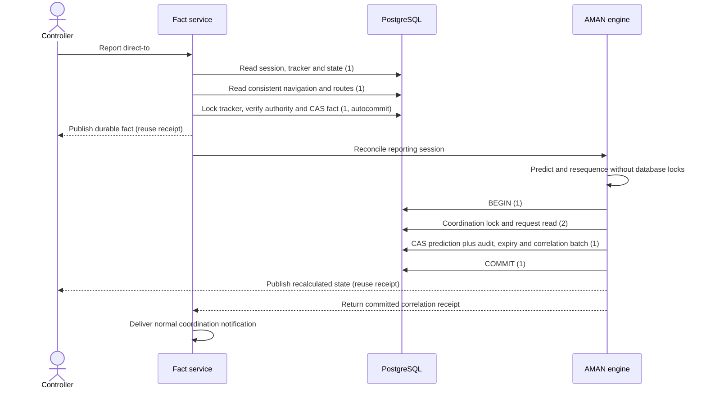

# AMAN route-fact SQL amplification

Successful warm changed events now use **8 SQL statements**, including full
synchronous reconciliation, both durable revisions, publication, audits,
coordination expiry and accepted-request correlation. Repeats use **7** and
clearing a direct uses **4**. A repeat that first correlates a newly accepted
request can add one write (8 total). The regression test enforces at most ten.

Worktree: `C:/Users/fsr19/.codex/worktrees/aman-route-fact-sql`, branch
`codex/aman-route-fact-sql`. The recorded benchmark baseline is
`05ab62a53a43780a5c7bc3adaef30e9d28e0a7f6`; the implementation is rebased onto
current main for integration validation. Aircraft position handlers were not
changed, and production was not changed during this investigation.

The subsequent [CPU follow-up](aman-route-fact-cpu.md) reduces the 132-arrival
median further to 764.706 ms while retaining eight statements and identical
published states. The measurements below document the earlier SQL-only stage.

## Production evidence

Trace `5799b7c97fdd8b7e2fb8db278205224b`, retrieved from
`grafanacloud-traces`, started on 2026-11-16 at 21:16:07.262 Copenhagen time
(20:16:07.262Z), session 1292, service version
`3.9.1+882a1238a602fb3627af14b45de61957513f7184`.

- Event duration: 8,032.98 ms; queue time: 0.039 ms.
- 6,296 spans, including 5,075 SQL statements totaling 4,398.40 ms.
- Fragment reads: 1,632 procedure, 678 terminal, 676 airport, 544 fix.
- 401 route reads, 272 active-manifest reads, 272 repeatable-read begins.
- Maximum pool acquisition: approximately 0.819 ms.

`ReportDirectTo` synchronously reconciled every session and every observed
arrival. Primary prediction repeatedly called `ActiveVersion`, `TerminalPath`,
`Route`, `hasResolvedRouteFixes`, and `ActiveGeometrySnapshot`; fallback and
publication also read snapshots. Every snapshot loaded fragments for validation
and then loaded them again for assembly in its own repeatable-read transaction.
The dominant problem was repeated work rather than pool exhaustion.

## Final statement accounting

| Work | SQL statements |
| --- | ---: |
| Joined session, current tracker and aggregate read | 1 |
| Consistent navigation snapshot and all retained routes | 1 |
| Atomic tracking guard and conditional durable fact replacement | 1 |
| Begin prediction persistence transaction | 1 |
| Existing coordination transaction lock | 1 |
| Read coordination requests under their existing row locks | 1 |
| Conditional prediction replacement, audit batch and coordination replacements | 1 |
| Commit prediction persistence transaction | 1 |
| **Total** | **8** |

The initial fact write is a single autocommit PostgreSQL statement, and is
fully durable before prediction starts. The later prediction transaction also
commits expiry, correlation and diagnostics atomically. The ordinary
`ObserveClearance` call consumes that committed result, preserves its service
notification, and does not open another transaction. A receipt becomes usable
only after COMMIT and is bound to the event's session, fact and pool. If
prediction fails or performs no commit, correlation retains its independent
transaction path. The accepted fact remains durable if prediction fails.

A repeat checks tracker and revision without rebuilding or uploading the entire
aggregate. Its historical fact is already durable; no aggregate write or lock
is needed. A clear does not correlate an accepted direct request, so its normal
path consists of the combined read, navigation read and two conditional writes.

These are full physical SQL statement counts, including explicit transaction
statements. CTEs batch real writes into one atomic statement; there are no
production stored procedures hiding additional SQL, telemetry filters or
background tasks used to satisfy the budget. Reconciliation remains synchronous.

## Safety and contention

Tracking ownership is checked under `FOR SHARE` on the target strip during the
fact write. A completed handoff causes rejection; an overlapping handoff
serializes with the fact. No tracking lock spans navigation, prediction or
publication. PostgreSQL row locks also conflict with position updates to that
same strip, but only during the short fact statement. Other aircraft's position
updates do not contend on this tracking guard.

Existing AMAN aggregates use a conditional replacement that checks revision
and the exact previously validated payload. The fact path takes a
`FOR NO KEY UPDATE` lock on that aggregate and a `FOR KEY SHARE` lock on its
session only within the write statement. It uses NOWAIT so it does not sit
waiting with another row locked. Conflicts invalidate the event view and retry
from fresh data with a short bounded backoff. The generic command path also
locks the aggregate row and conditionally writes its expected revision, so
mixed generic/fact writers cannot overwrite one another. Generic creation and
command idempotency retain their established protocol.

Session identity, live/training status and arrival runways are reused from the
validated event view. Every write checks session ownership; the prediction
write also checks that the live/training status and arrival-runway inputs still
match its calculation. A mismatch invalidates the view and replans. Publication
still enforces configured airport capabilities and session/airport identity,
using the just-validated view instead of duplicate lookups. Views cannot be
used by a different session or repository and are never a process-wide cache.

Coordination retains its existing session/airport advisory lock and request
row locks. They are acquired after prediction computation, only for the short
persistence transaction, to preserve submission/decision/expiry ordering and
coordination revision semantics. There is no new airport-wide AMAN lock on the
fact path and no lock held across expensive calculations.

Navigation is loaded in one statement with MVCC consistency. Validation and
assembly share the same decoded fragments. All canonical digests, route keys,
completeness checks, dataset matching and holding-conflict checks remain. The
view spans synchronous publication and reconciliation, including
`context.WithoutCancel`. External activation is visible to the next event;
local activation invalidates the pinned view so route repair can expand fixes.
Commit retries obtain fresh state; a fact retry also obtains fresh navigation.



## Before and after

PostgreSQL 16 Alpine ran on Docker Desktop with Go 1.26 on Windows. Each stage
ran serially for three samples; table timings are medians and exclude fixture
setup and verification reads. Raw samples, including the intermediate
navigation-only change, are in [aman-route-fact-sql.json](aman-route-fact-sql.json).
The checkout baseline differs from the production service version.

| Workload | Original SQL | Navigation-only SQL | Final SQL | Original latency | Final latency |
| --- | ---: | ---: | ---: | ---: | ---: |
| Changed direct, 1 arrival | 163 | 26 | 8 | 80.645 ms | 14.489 ms |
| Changed direct, 132 arrivals | 5,010 | 26 | 8 | 3,705.597 ms | 1,217.482 ms |
| Repeat, 1 arrival | 24 | 8 | 7 | 10.861 ms | 5.169 ms |
| Repeat, 132 arrivals | 24 | 8 | 7 | 31.270 ms | 23.124 ms |
| Clear, 1 arrival | not measured | not measured | 4 | not measured | 6.625 ms |
| Clear, 132 arrivals | not measured | not measured | 4 | not measured | 1,204.540 ms |
| Changed direct plus removal, expiry and audits | not measured | not measured | 8 | not measured | 101.598 ms |

The 132-arrival statement reduction is 99.84%; local full-event latency is
approximately 67% lower than the original. Its final latency is comparable to
the intermediate navigation-only median of 1,215.214 ms: sequencing CPU still
scales with arrival count. The smaller event and repeat workloads improve
further after redundant persistence work is removed.

The harness uses distinct persisted routes for every arrival, two sessions,
real authorization and aggregate repositories, and a matching accepted
coordination request. It exercises publication's session validation and
frontend/EuroScope projections with a recording socket sink. Session and runway
adapters use the same validated-receipt path as production. The removal case
also verifies expiry and retained diagnostics within the statement budget.
Geometry is synthetic and wind acquisition is unavailable. These are local
measurements, not a production replay or deployed latency guarantee.

The budget applies to successful warm events without retries. Revision/lock
conflicts, forced persistence failures and cold/source-driven route
materialization can add SQL; they remain visible to telemetry and are not
moved to background work. No count or latency claim excludes synchronous
reconciliation, transaction statements, publication validation or correlation.

## Validation

```text
go test ./internal/aman/... ./internal/coordinationrequest ./internal/repository/postgres ./internal/app ./pkg/events/... -count=1
go test -race ./internal/aman/routefact ./internal/aman/operational ./internal/coordinationrequest ./internal/repository/postgres ./internal/app -count=1
go test ./internal/aman/operational -run TestRouteFactFullEventSQLBudget -count=3 -v
```

All passed. Additional PostgreSQL checks cover handoffs before and during the
fact transaction, unchanged replay authorization, deleted sessions, concurrent
CAS and generic writers, same-revision payload replacement, runway changes,
nonblocking conflict handling, unrelated-aircraft updates, lock release before
prediction, all 30 audit records, atomic rollback of prediction/expiry/audit/
correlation, durable facts after a failure, independent correlation recovery,
and exactly-once service notification for the committed result. Existing
fallback direct-to, navigation corruption/activation, state validation,
publication and command-idempotency suites also pass.

The original baseline harness relaxed only the newly introduced SQL budgets,
other-session isolation assertion, and exact two-publication assertion. Durable
fact, prediction, correlation and state validation assertions remained active.
