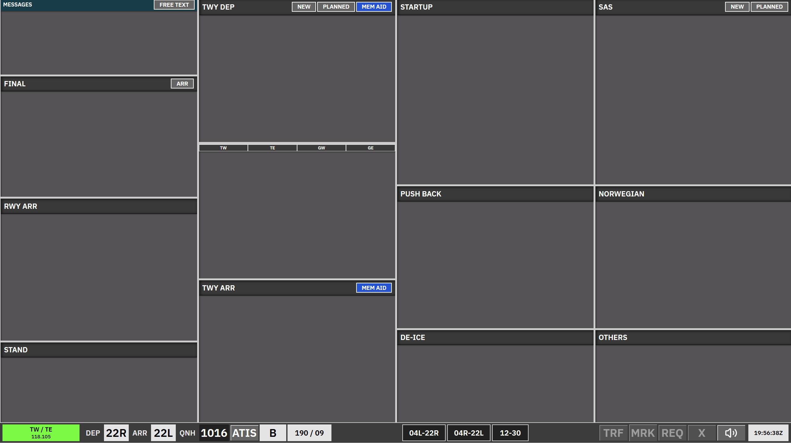

**AA + AD** is the combined ground scope: **Apron Arrival** and **Apron Departure** in one view. Use it when a single `_GND` position works both sides.

Strips are organised into **bays**. A bay is either **ACTIVE** or **LOCKED**. Strips you do not own can only be acted on with **REQ**, except fully **LOCKED** strip types which cannot be requested.

## Bay overview

| Bay | Strip type | Notes |
| --- | --- | --- |
| **Messages** | Messages | Free-text / coordination column. |
| **Final** | Arrival locked | Locked bay. |
| **RWY ARR** | `TWY-ARR` | Runway arrival segment. Can be REQ. |
| **STAND** | `APN-ARR` | Arrivals at gate/stand. Can be REQ. |
| **TWY ARR** | `APN-ARR` | Taxiing arrival after the runway; active. Transfer from GW by SI; move to STAND when parked. |
| **TWY DEP-UPR** | `APN-TAXI-DEP` | SI to ground west / splits. |
| **TWY DEP-LWR** | `APN-TAXI-DEP` | Aircraft cleared to the last hold-short before handoff; tower sees the right picture from here. |
| **Startup** | `APN-PUSH` | Strips arrive here after clearance when uncleared bays are active. Can be REQ in some cases. |
| **Push back** | `APN-PUSH` | Active. Release point chosen via pushback map; opens apron taxi map. |
| **De-ice** | `APN-TAXI-DEP` | Same strip family as TWY DEP; routing via hold-short links De-ice, TWY DEP-UPR, and TWY DEP-LWR. |
| **SAS** | Uncleared | Small strips while another controller covers CLR DEL; full-size otherwise. Cannot be selected or dragged. |
| **Norwegian** | Uncleared | Same as SAS. |
| **Others** | Uncleared | Same uncleared behaviour as [CLR DEL](/ekch/clr-del/); sorted top-down. |

## Arrival side

- **Final** is locked; **RWY ARR** uses the `TWY-ARR` strip and may be REQ'd.
- **TWY ARR** and **STAND**: taxi on TWY ARR, park on STAND. STAND strips time out after a short period at the gate.

## Departure side

- **Others**, **SAS**, **Norwegian**: uncleared departures awaiting clearance. Issuing a clearance sends the strip to **Startup**.
- **Startup** → **Push back** (release point chosen on pushback map) → **De-ice** / **TWY DEP-UPR** / **TWY DEP-LWR** via hold-short selections on the apron taxi map.
- Selecting **K2**, **K3**, **A**, **F**, **D**, **B**, **V2**, or **V1** on the apron taxi map moves the strip to **TWY DEP-LWR**, even without another apron or tower controller online. The existing **K1** lower-bay routing is unchanged.
- **Startup** and **Push back** strips do not display the next frequency below the callsign. SI ownership indicators and transfer actions are unchanged.

## REQ and transfers

- Select an owned aircraft's callsign, then use **TW**, **TE**, **GW**, or **GE** in **TWY DEP** to change its next-controller SI target without starting a transfer. Click **SI** separately to initiate the handoff. The selection survives routing updates until ownership changes. The buttons retain their normal colors regardless of controller availability. If the target is offline, the existing SI value is unchanged; a blank SI stays blank.
- Bays marked **Can be REQ** allow requesting a strip you do not own.
- **TWY DEP-LWR** SI creates normal pending coordination to the next carried step in the configured route:
  - 22R/04L: AD → GW → TW
  - 04R/30: AD → GW → TE
  - 22L: AD → TE
  - 12: AD → TW
- Cross-coupled targets use the carrying primary while displaying the logical identifier frequency. For example, when TW or GE carries GW, AD transfers to that primary but the strip shows **GW 118.580**. When GW is not carried and GE is the configured owner of the GW sector, AD transfers to GE and the strip shows **GE 121.830**.
- A controller primed on the sector frequency takes precedence over another controller carrying that same frequency. When the sector frequency is not carried, a staffed configured fallback primary takes precedence over a controller carrying only a fallback frequency.
- Manual moves are allowed between **ACTIVE** bays.

For clearance dialogue, PDC strip colours, and delivery workflow, see [CLR DEL](/ekch/clr-del/) and [Pre-departure clearance](/concepts/pre-departure-clearance/).
