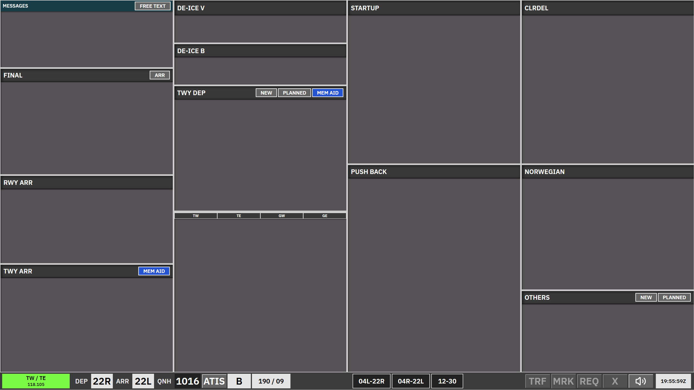

import { Aside } from '@astrojs/starlight/components';

**Apron Departure** is used when the apron is split and one of these applies:

- **B_GND** — A_GND is online and C_GND is offline, or
- **C_GND** — B_GND and A_GND are both online.

Strip behaviour matches [AA + AD](/ekch/aa-ad/) in general, but this scope has a smaller set of bays and some columns are locked.

In **STARTUP** and **PUSH BACK**, strips do not display the next frequency below the callsign. SI ownership indicators and transfer actions are unchanged.

Selecting **K2**, **K3**, **A**, **F**, **D**, **B**, **V2**, or **V1** on the apron taxi map moves the strip to **TWY DEP-LWR**, regardless of other controllers being online. The existing **K1** lower-bay routing is unchanged.

<Aside type="caution">
**RWY ARR** holds **ARR-LOCKED** strips in a locked bay here — not the `TWY-ARR` REQ strip used in [AA + AD](/ekch/aa-ad/) and [Apron Arrival](/ekch/apn-arr/). **Push back** is also locked; there is no separate **TWY DEP** or **Startup** column in this scope.
</Aside>

## Bay overview

| Bay | Strip type | Notes |
| --- | --- | --- |
| **Messages** | Messages | Coordination / free-text. |
| **Final** | Arrival locked | Locked — not accessible in this scope. |
| **RWY ARR** | Arrival locked (`ARR-LOCKED`) | Locked — not the same strip as RWY ARR in AA+AD / Apron Arrival. |
| **STAND** | `APN-ARR` | Active. |
| **TWY ARR** | `APN-ARR` | Apron arrival taxi; active. |
| **De-ice** | `APN-TAXI-DEP` | Active — taxi / de-ice routing. |
| **Push back** | `APNPUSH` | Locked — not accessible in this scope. |
| **SAS** | Uncleared | Small strips while another controller covers CLR DEL; full-size otherwise. Cannot be selected or dragged. |
| **Norwegian** | Uncleared | Same as SAS. |
| **Others** | Uncleared | Same family as [CLR DEL](/ekch/clr-del/). |

## Using this scope

Active bays (**STAND**, **TWY ARR**, **De-ice**) cover apron arrival and de-ice taxi movements. Locked columns are visible for situational awareness but are not manipulated here.

Use **REQ** only where the bay and strip type allow — locked bays do not offer REQ behaviour.

For full pushback → taxi → **TWY DEP** sequencing, see [AA + AD](/ekch/aa-ad/) or [Apron Arrival](/ekch/apn-arr/). For clearance and PDC, see [CLR DEL](/ekch/clr-del/) and [Pre-departure clearance](/concepts/pre-departure-clearance/).

## Related

- [AA + AD](/ekch/aa-ad/) — full combined layout
- [Apron Arrival](/ekch/apn-arr/) — A_GND with B/C online
