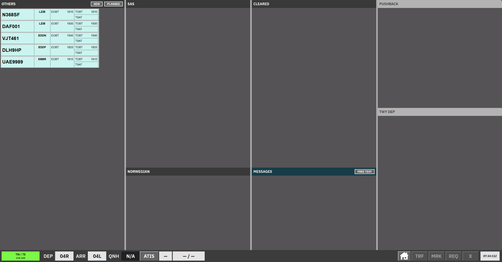
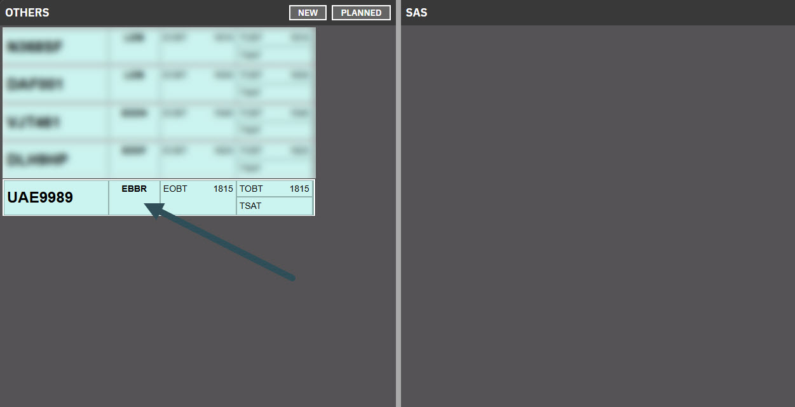
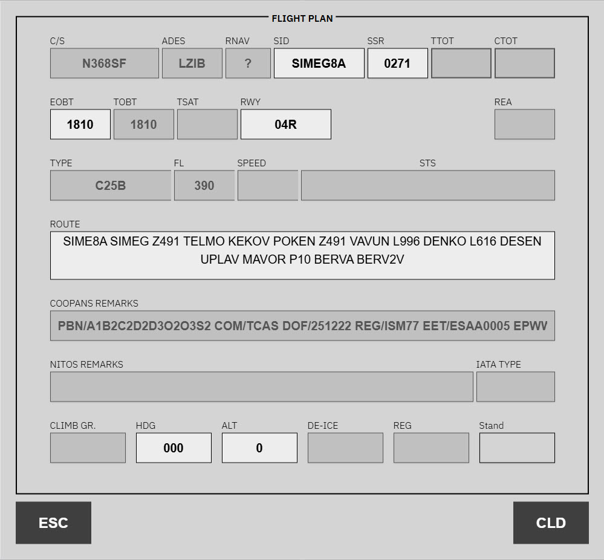
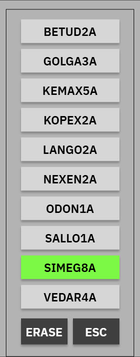
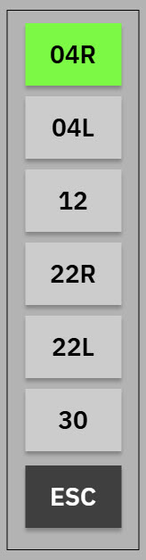
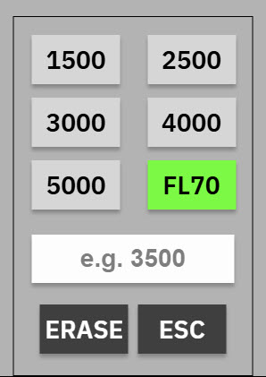

import { Aside, Steps } from '@astrojs/starlight/components';

**CLR DEL** is the scope for **EKCH_DEL** when **121.905**, **121.630**, and **121.730** are all primed. Otherwise delivery uses [SEQ PLN](/ekch/seq-pln/). Uncleared departures sit in airline bays; issuing a clearance automatically moves the strip to **Cleared**.

<Aside type="caution">
Planned departure strips in **Others**, **SAS**, **Norwegian**, and **CLR DEL** cannot be selected or dragged, regardless of strip size. Issuing a clearance via the ATC clearance window still moves them to the cleared workflow. The **PLANNED DEP** popup is unchanged.
</Aside>

In **AA + AD**, **APRON ARR**, and **APRON DEP**, these strips use the small format while another operational controller covers **CLR DEL**. In **TWR + GND**, **TE + TW**, and **GE + GW**, they use the small format while another operational controller covers any **APRON** sector. Otherwise they use full-size strips.

## Bay overview

| Bay | Strip type | Notes |
| --- | --- | --- |
| **Others** | Uncleared | Sorted top-down (opposite to most bays). |
| **SAS** | Uncleared | Airline grouping. |
| **Norwegian** | Uncleared | Airline grouping. |
| **Cleared** | Cleared | Strips move here after **CLD**. |
| **Messages** | Messages | Coordination / free-text. |
| **Push back** | Departure locked | Locked — context only. |
| **TWY DEP** (upper) | Departure locked | Locked. |
| **TWY DEP** (lower) | Departure locked | Locked. |

## Messages

**FREE TEXT** opens the message composer. The top-left field is a read-only
preview of the text that **OK** sends. Presets, a single **TWY** selection,
**RWY** selection, **+ CLOSED**, **+ OUT OF USE**, and additional free text can
be combined. Offline recipients are disabled using the same direct and
cross-coupled coverage rules as manual transfer; **BROADCAST** clears individual
recipient selections.

Optional UTC times use the keypads: **NOW** sets the start time and **UFN**
sets an open-ended end time. They append `STARTING AT HHMM, until HHMM/UFN`.
Each time panel's **ERASE** clears that time. The recipient panel's **ERASE**
removes the last word of the message text, **DELETE MESSAGE** clears all content
and timings, and **ESC** closes without sending. The existing 120-character
limit applies to the complete message; invalid times and overlong messages are
shown explicitly and cannot be sent.

**AUTO** uses large message-strip text for a single recipient and small text
for broadcast or multiple recipients. **SMALL** and **LARGE** override it for
everyone receiving the message.

## Cleared strips

Completing a voice clearance immediately assigns the strip to SEQ PLN when **121.905** or **119.905** is primed or cross-coupled, preferring coverage of **121.905**. For PDC, ownership changes only after the pilot acknowledges. The issuing scope does not change this selection. No receiving-controller acceptance is required.

- **Any G or APRON SOUTH stand:** SEQ PLN → GE 121.830 → the applicable tower.
- **W1, RI, RII, RIII:** SEQ PLN → GW 118.580 → the applicable tower.
- **Other stands:** SEQ PLN → AD 121.730 → the configured ground/tower route. Consecutive steps carried by the same primary do not create a self-transfer.

CLR DEL on **119.905** acts as SEQ PLN when no controller carries **121.905**. If neither planner frequency is carried, SQ is skipped and the strip goes directly to the stand's **AD**, **GE**, or **GW** controller, using configured combined coverage when needed. Inheriting the SQ sector alone does not count as planner staffing. If no route or recipient can be resolved, ownership stays unchanged.

The strip remains blue in **Cleared** here after ownership passes to SEQ PLN and appears simultaneously in **STARTUP** on SEQ PLN and apron. Ownership alone does not turn the CLR DEL strip gray; tag-request and closed-runway highlights still apply. Cross-coupled coverage assigns the controller's primary frequency as owner.

## Issue a clearance

### Planned departure time colors

In the flight-plan dialog, **TSAT** is read-only and uses the same background
as **TTOT**. The white **REA** field sends a ready request and displays **REA**
after confirmation. It sets TOBT to the current UTC time only when TOBT is
more than six minutes in the future; otherwise TOBT is unchanged. Other READY
controls retain their existing timing rules.

TOBT and TSAT have no timing or invalid-phase coloring while a departure is
in a planned departure bay. Coloring activates after clearance. This applies
across all scopes and EST; CTOT coloring is unchanged.

### RNAV indication

The RNAV field is blank when RNAV 1 is available; otherwise it shows **NON**
for filed RNAV 2, 5, 10, or NIL. Clicking the field opens the SID/RNAV menu
without changing the flight plan.

The following aircraft types are assumed to have RNAV 1 for display and RNAV
validation, regardless of their filed equipment/PBN value:
**A3\*\***, **B736**, **B737**, **B738**, **B739**, **B38M**, **B744**, **B748**,
**B752**, **B753**, **B762**, **B763**, **B764**, **B77\***, **B78\***,
**BCS3**, **AT\*\***, **DH8D**, **CRJ\***, **E\*\*\***, and **MD8\***.
Each `*` matches exactly one letter or digit. This assumption does not rewrite
the flight plan. RNAV 1 availability also clears the RNAV error highlight and
obsolete RNAV validation remarks immediately, without hiding unrelated faults.
When RNAV 1 is assumed rather than filed, INTERNAL REMARKS shows:
"Aircraft filed without RNAV capability, but corrected based on A/C Type.
Consider verification if deemed relevant." This is informational and does not
change the external flight-plan remarks.

Pressing **REMOVE NON RNAV** applies RNAV 1 immediately: the equipment `R`
marker is added if missing, and the PBN entry is replaced with
`PBN/A1B1C1D1S1S2`, preserving unrelated remarks. The RNAV field then becomes
blank; merely opening or dismissing the menu does not clear **NON**.

<Steps>

1. Click the **Destination / Stand** column on the strip.

   

2. Review and update fields in the flight plan editor.

   - **Disabled** — read-only; pilots must refile to change.
   - **Dropdown** — valid options for this strip.
   - **Free-text** — e.g. **ROUTE**.

   
   
   
   

3. Click **CLD** to confirm the clearance and move the strip to **Cleared**.

</Steps>

## Pre-departure clearance (PDC / datalink)

CLR DEL only needs to act when a PDC request raises a validation or contains manual remarks.

**NEXT FRQ** uses the same stand-specific recipient selection as automatic clearance ownership, including combined and cross-coupled coverage. It is the receiving controller's primary frequency. If no route or recipient resolves, PDC cannot be issued. Ownership still changes only after pilot acknowledgment; the frequency is selected when the clearance is issued.

| State | Strip | Action |
| --- | --- | --- |
| PDC invalid | Callsign blinks grey | **OPEN DCL MENU** in the validation dialog |
| Custom PDC | Normal strip; validation prompts manual handling | **OPEN DCL MENU** |
| Cleared via PDC | Strip in Cleared with navy callsign until pilot acknowledges | — |

Use **REVERT TO VOICE** in the DCL window to abandon the datalink path.

See [Pre-departure clearance](/concepts/pre-departure-clearance/) and [Validation status](/concepts/validation-status/).

## Related

- [AA + AD](/ekch/aa-ad/) — combined apron after handoff
- [SEQ PLN](/ekch/seq-pln/) — startup sequencing
- [Apron Departure](/ekch/apn-dep/) — B/C_GND split layout
