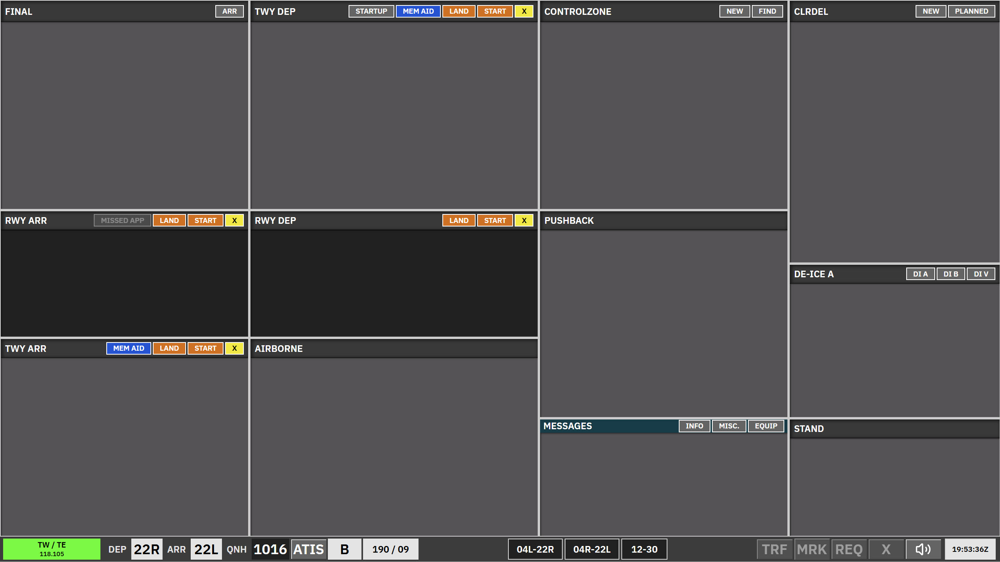

import { Aside } from '@astrojs/starlight/components';

**TE + TW** is the tower scope for **EKCH_A_TWR** and **EKCH_D_TWR**, using the **TWR aspect** layout.

<Aside>
Cleared departure strips are **not listed as normal strips** in this scope. Use the **Startup** bay header to open the startup dialogue and approve pushback. If any apron controller is online, the startup list is limited to stands **G110–G137**, **W1**, and **AS**.
</Aside>

## Bay overview

| Bay | Strip type | Notes |
| --- | --- | --- |
| **Final** | `TWR-ARR` | Arriving aircraft; concerned (purple) until assumed. |
| **RWY ARR** | `TWR-ARR` | On the runway for landing. |
| **TWY ARR** | `APN-ARR` | Taxiing arrival after the runway. |
| **TWY DEP (TWR)** | `TWR-DEP` | Synced with apron TWY DEP-LWR. Can be REQ. |
| **RWY DEP** | `TWR-DEP` | Holding for takeoff. |
| **Airborne** | `TWR-DEP` | After takeoff until tag is assumed. |
| **Control zone** | Control zone | VFR strips only — no SI transfers. |
| **Push back (TWR)** | `APNPUSH` | Can be REQ. |
| **Messages** | Messages | Coordination / free-text. |
| **CLR DEL** | Uncleared | Small strips while another apron controller is online; full-size otherwise. Cannot be selected or dragged. The same rule applies to TWR + GND. |
| **De-ice A** | `APNPUSH` | Same strip family as other pushback/taxi strips. |
| **Stand** | `APN-ARR` | At gate / stand. |

## Arrivals — Final and RWY ARR

- Strips appear in **Final**; use **ARR** in the bay header to open the ARR dialogue if a strip is missing.
- **Callsign** opens the ARR dialogue; **FORCE ASSUME** assumes the strip and prioritises it.
- Click the arrival runway to move a strip from **Final** to **RWY ARR**. Runway colour reflects clearance state (green / red) based on other traffic in the bay.
- The strip moves to **TWY ARR** automatically when the aircraft leaves the runway area; manual moves are also available.
- TE/TW handovers from **TWY ARR** retain the existing arrival-route target.
- Select an owned aircraft's callsign, then use **AA**, **GW**, or **TW/TE** in **TWY ARR** to change its next-controller SI target without starting a transfer. Click **SI** separately to initiate the handoff. The selection survives routing updates until ownership changes. The buttons retain their normal colors regardless of controller availability. If the target is offline, the existing SI value is unchanged; a blank SI stays blank.

## Departures — TWY DEP-TWR, RWY DEP, Airborne

- Click the departure runway to move a strip from **TWY DEP-TWR** to **RWY DEP**. Same green / red clearance logic applies.
- The strip moves to **Airborne** automatically when the aircraft is airborne; **SI** then targets the departure frequency.
- Manual move from **RWY DEP** to **Airborne** is possible; SI still drives the downstream handoff.
- TE and TW display the active RIU/runway frequency; cross-coupling routes the action to the carrying primary.

## Control zone

Use **New** / **Find** in the bay header for VFR strips only. No transfers.

**FIND** opens a scrollable list of filed VFR flights across the session, including arrivals, departures, and transits. Sort by callsign, departure airport, or destination. Selecting a flight adds it to **Control zone**; **DISMISS** closes the list without moving a flight. Use **NEW** for an aircraft without a filed flight plan. This dialogue is also available in **TWR + GND**.

## Related

- [GE + GW](/ekch/ge-gw/) — tower ground
- [AA + AD](/ekch/aa-ad/) — apron combined scope
